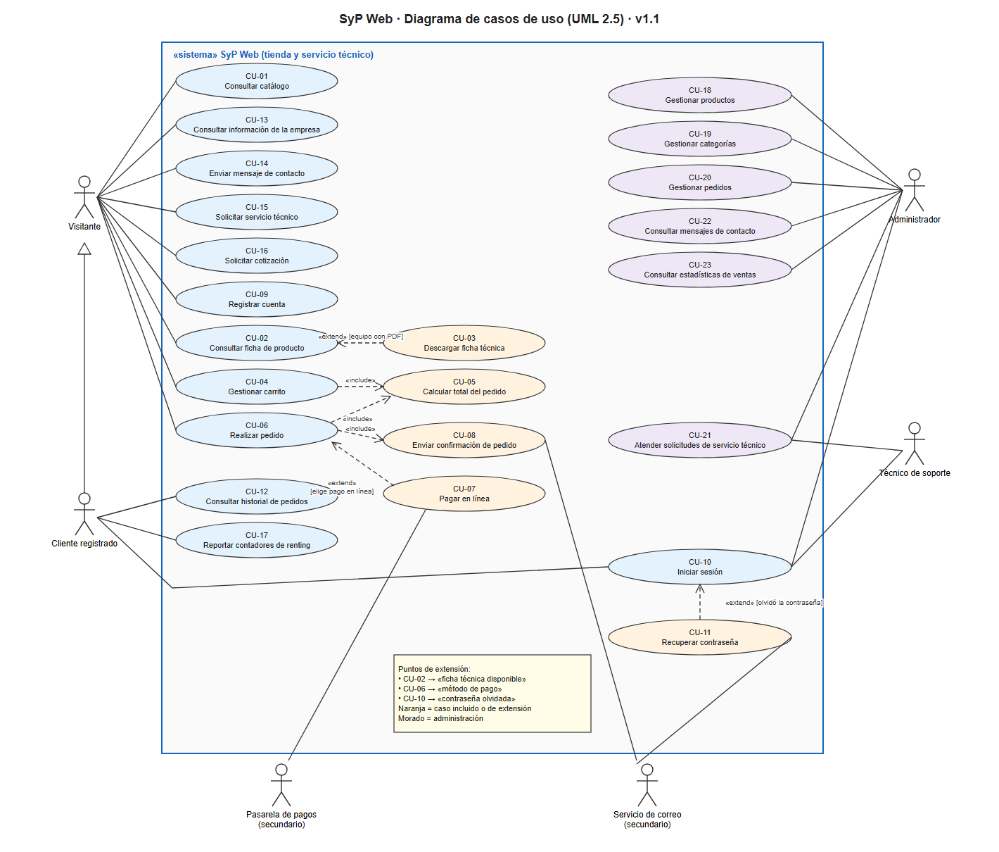

# 3. Diagrama de casos de uso: actores, casos y relaciones

Diagrama: [`diagramas/casos-de-uso.svg`](diagramas/casos-de-uso.svg) · [`.png`](diagramas/casos-de-uso.png) · fuente editable [`diagramas/casos-de-uso.drawio`](diagramas/casos-de-uso.drawio) (se abre en diagrams.net).

## 3.1 Actores

| Actor | Tipo | Descripción |
|---|---|---|
| Visitante | Primario | Navega el catálogo sin cuenta; puede pedir servicio técnico, cotizar, contactar y comprar como invitado (RF-06.5) |
| Cliente registrado | Primario | **Es un** Visitante (generalización de actores): hereda todos sus casos y además consulta su historial y reporta contadores |
| Administrador | Primario | Propietaria o personal autorizado; gestiona catálogo, pedidos, solicitudes y mensajes |
| Técnico de soporte | Primario | Atiende las solicitudes de servicio técnico |
| Pasarela de pagos | Secundario | Sistema externo que procesa el pago en línea; solo responde, no inicia casos |
| Servicio de correo | Secundario | Sistema externo que entrega confirmaciones y enlaces de recuperación; solo recibe información |

## 3.2 Casos de uso (23)

Cada nombre es **verbo + objeto** y representa un objetivo del actor. Las operaciones de alta, consulta, edición y retiro se agrupan en «Gestionar …» (regla 1 de arbitraje): ninguna tiene un actor o un flujo propio que justifique separarla.

| ID | Caso de uso | Actor(es) / iniciador | Requisitos |
|---|---|---|---|
| CU-01 | Consultar catálogo | Visitante | RF-01, RF-02.1 a RF-02.4 |
| CU-02 | Consultar ficha de producto | Visitante | RF-03.1, RF-03.2, RF-03.3 |
| CU-03 | Descargar ficha técnica | Extiende CU-02 | RF-03.5 |
| CU-04 | Gestionar carrito | Visitante | RF-03.4, RF-04.1, RF-04.3, RF-04.4 |
| CU-05 | Calcular total del pedido | Incluido por CU-04 y CU-06 | RF-04.2, RF-05.2 |
| CU-06 | Realizar pedido | Visitante (invitado) y Cliente registrado | RF-05.1, RF-05.3, RF-06.5 |
| CU-07 | Pagar en línea | Extiende CU-06 · secundario: Pasarela de pagos | RF-05.3 |
| CU-08 | Enviar confirmación de pedido | Incluido por CU-06 · secundario: Servicio de correo | RF-05.4 |
| CU-09 | Registrar cuenta | Visitante | RF-06.1 |
| CU-10 | Iniciar sesión | Cliente registrado, Administrador, Técnico | RF-06.2, RF-10.1 |
| CU-11 | Recuperar contraseña | Extiende CU-10 · secundario: Servicio de correo | RF-06.3 |
| CU-12 | Consultar historial de pedidos | Cliente registrado | RF-06.4 |
| CU-13 | Consultar información de la empresa | Visitante | RF-07, RF-08.1 a RF-08.4 |
| CU-14 | Enviar mensaje de contacto | Visitante | RF-08.5 |
| CU-15 | Solicitar servicio técnico | Visitante | RF-09.1, RF-09.2 |
| CU-16 | Solicitar cotización | Visitante | RF-12 |
| CU-17 | Reportar contadores de renting | Cliente registrado | RF-13 |
| CU-18 | Gestionar productos | Administrador | RF-10.2 |
| CU-19 | Gestionar categorías | Administrador | RF-10.3 |
| CU-20 | Gestionar pedidos | Administrador | RF-10.4 |
| CU-21 | Atender solicitudes de servicio técnico | Administrador, Técnico | RF-09.3, RF-10.5 |
| CU-22 | Consultar mensajes de contacto | Administrador | RF-10.6 |
| CU-23 | Consultar estadísticas de ventas | Administrador | RF-10.7 |

**Casos críticos** (acordados en la revisión del sprint 1): **CU-06 Realizar pedido**, **CU-15 Solicitar servicio técnico** y **CU-18 Gestionar productos**. Se detallan en el producto 2.

## 3.3 Relaciones y su justificación (una línea cada una)

La flecha de «include» va del caso base al incluido; la de «extend» va del caso que extiende al caso base, con su punto de extensión.

| Relación | Tipo | Justificación |
|---|---|---|
| CU-04 Gestionar carrito → CU-05 Calcular total del pedido | «include» | Cada vez que se agrega, cambia o quita un producto el sistema **siempre** recalcula el total (RF-04.2). |
| CU-06 Realizar pedido → CU-05 Calcular total del pedido | «include» | El resumen previo a confirmar **siempre** muestra subtotal, IVA y total (RF-05.2); se reutiliza el mismo cálculo del carrito. |
| CU-06 Realizar pedido → CU-08 Enviar confirmación de pedido | «include» | Todo pedido confirmado **siempre** genera número único y confirmación al cliente (RF-05.4). |
| CU-07 Pagar en línea → CU-06 Realizar pedido | «extend» | **Condicional**: solo ocurre si el cliente elige pago en línea en el punto de extensión «método de pago»; con transferencia o contraentrega el pedido termina sin él (RF-05.3). |
| CU-03 Descargar ficha técnica → CU-02 Consultar ficha de producto | «extend» | **Opcional**: solo para equipos que tienen ficha PDF (RF-03.5); un tóner no la tiene y la ficha se consulta igual. |
| CU-11 Recuperar contraseña → CU-10 Iniciar sesión | «extend» | **Condicional**: solo si el usuario indica que olvidó la contraseña en el punto «contraseña olvidada» (RF-06.3). |
| Cliente registrado → Visitante | Generalización (actores) | El cliente registrado **es un** visitante con cuenta: hace todo lo del visitante y además CU-10, CU-12 y CU-17. Evita duplicar 9 asociaciones. |

**Iniciador de cada caso:** los casos incluidos (CU-05, CU-08) los inicia su caso base; los de extensión (CU-03, CU-07, CU-11) los inicia el caso que extienden. Los actores secundarios no inician casos (regla 6 de arbitraje).

**Por qué no hay ciclos ni duplicados:** ningún caso incluido o de extensión incluye a su vez a su caso base, y CU-05 se reutiliza en lugar de repetirse dentro de CU-04 y CU-06.

## 3.4 Qué ajusté respecto al diagrama del equipo

El diagrama original del equipo (`docs/Spain/srs_use_case_diagram.png`, 10 casos) se tomó como base. Cambios concretos:

1. Los actores con **nombres de personas reales** se cambiaron por roles (Administrador, Técnico de soporte), porque un actor es un rol y el repositorio es público.
2. Se **separaron los objetivos**: «Gestión de Cuenta y JWT» mezclaba registro, inicio de sesión y tecnología (JWT); quedó como CU-09, CU-10 y CU-11, sin detalle técnico.
3. Se agregaron **3 «include» y 3 «extend»** que no existían, con su justificación.
4. Los nombres se pasaron a **verbo + objeto** («Gestión CRUD Productos» → «Gestionar productos»; «Panel y analítica SyP» → «Consultar estadísticas de ventas»).
5. Se agregaron los **actores secundarios** (Pasarela de pagos y Servicio de correo) y la **generalización** Cliente registrado → Visitante.
6. Se agregaron casos que el SRS pedía y el diagrama no tenía: CU-13 (información de la empresa), CU-14 y CU-22 (mensajes de contacto), CU-12 (historial).
