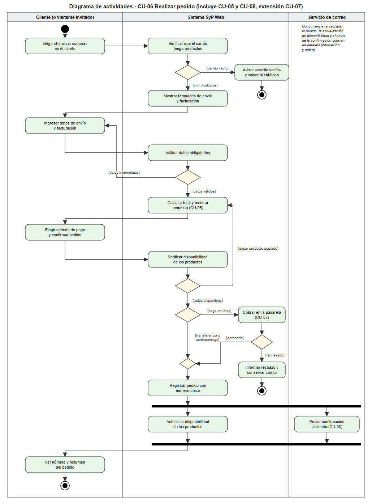
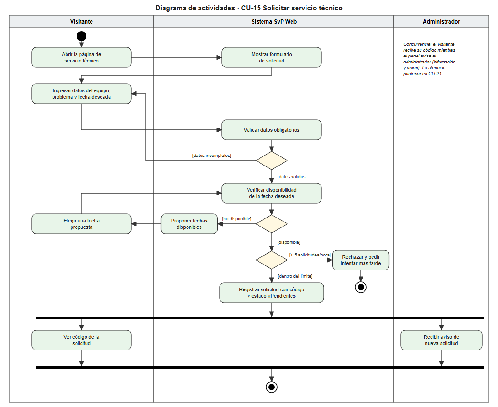

# 1. Diagramas de actividades (casos críticos)

Casos críticos: CU-06 Realizar pedido y CU-15 Solicitar servicio técnico (los de mayor riesgo para el negocio: dinero y atención al cliente). Fuente editable `.drawio` (diagrams.net) e imagen `.svg`/`.png` de cada uno.

## 1.1 CU-06 Realizar pedido

[`diagramas/actividades-cu06-realizar-pedido.drawio`](diagramas/actividades-cu06-realizar-pedido.drawio) · [`.svg`](diagramas/actividades-cu06-realizar-pedido.svg)

- **Calles:** Cliente (o visitante invitado), Sistema SyP Web, Servicio de correo.
- **Decisiones y guardas (todas las salidas cubiertas):**

| Decisión | Guardas | Paso en la plantilla |
|---|---|---|
| ¿El carrito tiene productos? | [carrito vacío] / [con productos] | Excepción 2a |
| ¿Datos completos? | [datos incompletos] / [datos válidos] | Alterno 4a |
| ¿Productos disponibles? | [algún producto agotado] / [todos disponibles] | Alterno 7a |
| ¿Método de pago? | [pago en línea] / [transferencia o contraentrega] | Alterno 6a (extensión CU-07) |
| ¿Respuesta de la pasarela? | [aprobado] / [rechazado] | Excepción 6b |

- **Concurrencia:** sí hay. Al registrar el pedido, la actualización de disponibilidad (Sistema) y el envío de la confirmación (Servicio de correo) ocurren en paralelo → **bifurcación y unión**.

## 1.2 CU-15 Solicitar servicio técnico

[`diagramas/actividades-cu15-solicitar-servicio.drawio`](diagramas/actividades-cu15-solicitar-servicio.drawio) · [`.svg`](diagramas/actividades-cu15-solicitar-servicio.svg)

- **Calles:** Visitante, Sistema SyP Web, Administrador.

| Decisión | Guardas | Paso en la plantilla |
|---|---|---|
| ¿Datos completos? | [datos incompletos] / [datos válidos] | Alterno 4a |
| ¿Fecha disponible? | [no disponible] / [disponible] | Alterno 5a |
| ¿Límite de solicitudes? | [> 5 solicitudes/hora] / [dentro del límite] | Excepción 6a |

- **Concurrencia:** sí hay. El visitante ve su código mientras el panel avisa al administrador → **bifurcación y unión**.
