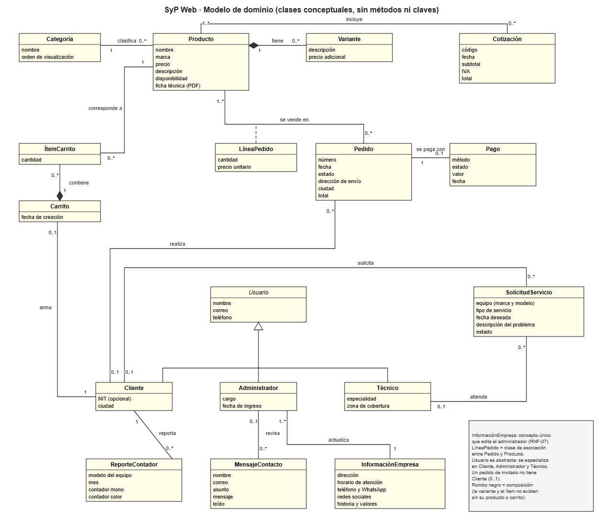
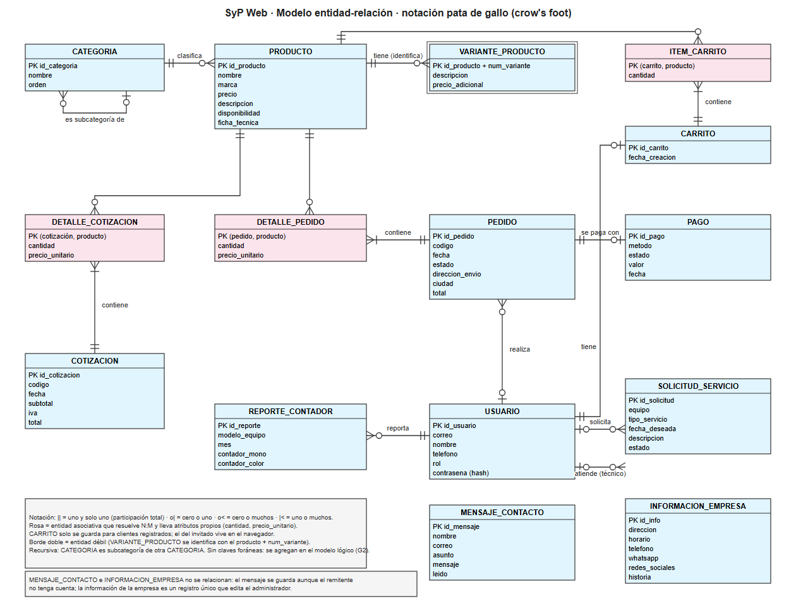
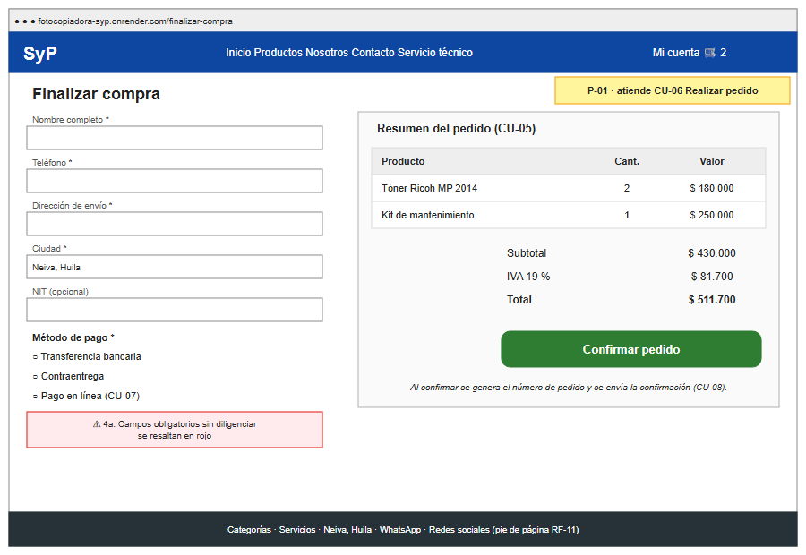
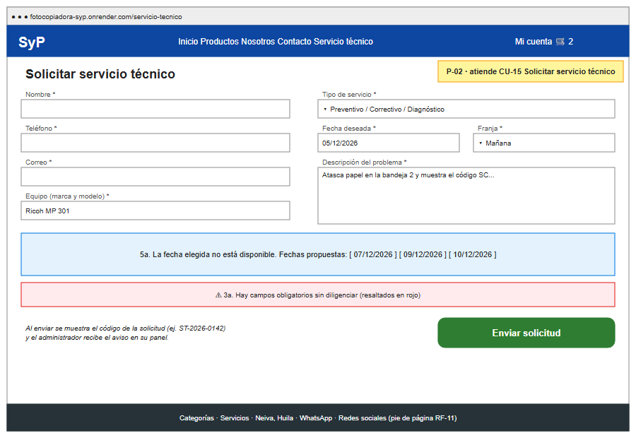
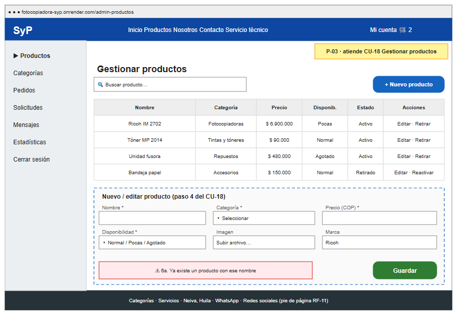

# 3. Modelo de dominio, modelo entidad-relación y prototipo

## 3.1 Modelo de dominio

[`diagramas/modelo-dominio.drawio`](diagramas/modelo-dominio.drawio) · [`.svg`](diagramas/modelo-dominio.svg)

- **17 clases conceptuales**, sin métodos y sin claves: Categoría, Producto, Variante, Cotización, ÍtemCarrito, Carrito, LíneaPedido, Pedido, Pago, Usuario, Cliente, Administrador, Técnico, SolicitudServicio, ReporteContador, MensajeContacto, InformaciónEmpresa.
- **Atributos de negocio:** todas las clases salvo ÍtemCarrito y Carrito tienen 2 o más (por ejemplo, Pedido: número, fecha, estado, dirección de envío, ciudad, total).
- **Generalización:** Usuario (abstracta) → Cliente, Administrador, Técnico.
- **Clase de asociación:** LíneaPedido entre Pedido y Producto (cantidad y precio unitario son del par pedido-producto, no de uno solo).
- **Composición:** Producto ◆— Variante y Carrito ◆— ÍtemCarrito.
- **Multiplicidades clave:** Cliente 0..1 — 0..* Pedido (el invitado no tiene cliente); Pedido 0..* — 1..* Producto; Pedido 1 — 0..1 Pago; Técnico 0..1 — 0..* SolicitudServicio.
- **Coherencia con las plantillas:** cada concepto que aparece en las plantillas existe aquí (carrito, pedido, producto, disponibilidad, pago, solicitud, fecha deseada, categoría, ficha técnica).
- **Base reutilizada:** el diagrama de clases del equipo y las tablas del backend. Le quité métodos, tipos y claves foráneas para dejar solo conceptos del negocio.

## 3.2 Modelo entidad-relación (notación pata de gallo)

[`diagramas/modelo-entidad-relacion.drawio`](diagramas/modelo-entidad-relacion.drawio) · [`.svg`](diagramas/modelo-entidad-relacion.svg)

- **Notación declarada:** pata de gallo (crow's foot). `||` = uno obligatorio (participación total), `o|` = cero o uno, `o<` = cero o muchos, `|<` = uno o muchos.
- **15 entidades** con identificador (PK): CATEGORIA, PRODUCTO, VARIANTE_PRODUCTO, ITEM_CARRITO, CARRITO, DETALLE_COTIZACION, COTIZACION, DETALLE_PEDIDO, PEDIDO, PAGO, USUARIO, SOLICITUD_SERVICIO, REPORTE_CONTADOR, MENSAJE_CONTACTO, INFORMACION_EMPRESA.
- **N:M resueltas con entidad asociativa con atributos propios:** PEDIDO–PRODUCTO → DETALLE_PEDIDO (cantidad, precio_unitario); COTIZACION–PRODUCTO → DETALLE_COTIZACION (cantidad, precio_unitario); CARRITO–PRODUCTO → ITEM_CARRITO (cantidad).
- **Entidad débil:** VARIANTE_PRODUCTO (se identifica con el producto + num_variante).
- **Relación recursiva:** CATEGORIA «es subcategoría de» CATEGORIA (0..1 a 0..N).
- **Requisitos de datos soportados:** las 6 entidades del modelo preliminar del SRS (sección 4) más pago, cotización, contador, carrito e información de la empresa.

## 3.3 Prototipo inicial (3 pantallas, una por caso crítico)

Todas las pantallas muestran la cabecera con menú, la cuenta, el contador del carrito y el pie de página (RF-11). Cada una lleva rótulo con su caso de uso y los mensajes de sus flujos alternos y excepciones.

| Pantalla | Caso de uso | Archivo |
|---|---|---|
| P-01 Finalizar compra | CU-06 Realizar pedido | [png](prototipo/P-01-cu06-realizar-pedido.png) · [drawio](prototipo/P-01-cu06-realizar-pedido.drawio) |
| P-02 Solicitar servicio técnico | CU-15 Solicitar servicio técnico | [png](prototipo/P-02-cu15-solicitar-servicio.png) · [drawio](prototipo/P-02-cu15-solicitar-servicio.drawio) |
| P-03 Gestionar productos | CU-18 Gestionar productos | [png](prototipo/P-03-cu18-gestionar-productos.png) · [drawio](prototipo/P-03-cu18-gestionar-productos.drawio) |

Base reutilizada: las páginas reales del sitio del equipo (`servicio-tecnico.html`, `admin.html` y el checkout de `productos.html`), redibujadas como bocetos de baja fidelidad y rotuladas con su caso de uso.
