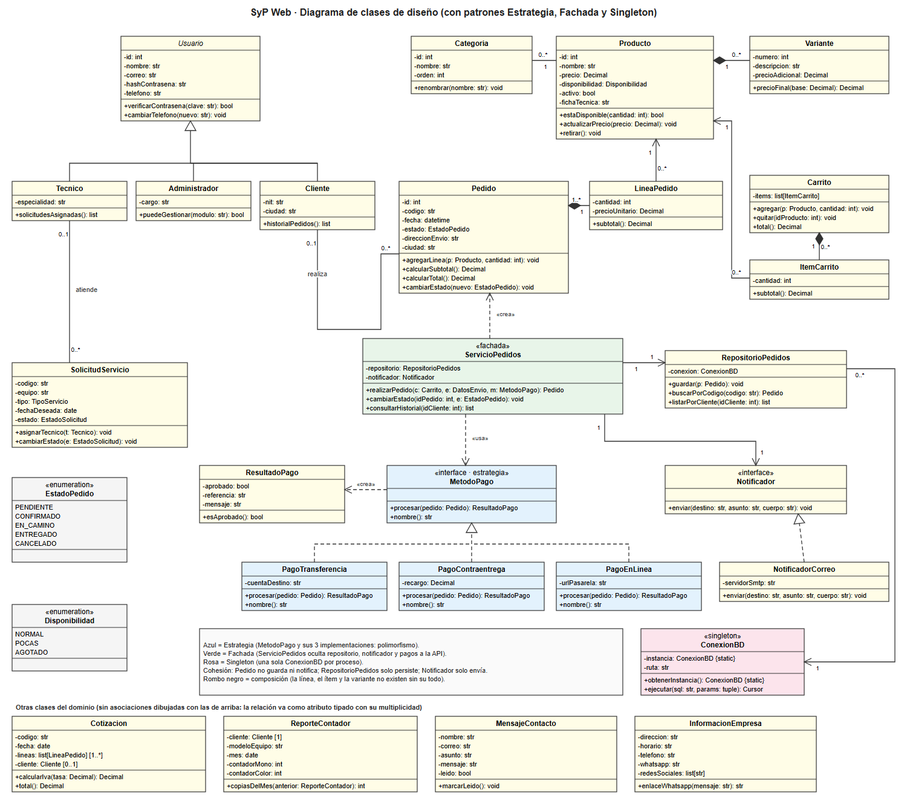

# A2 · Diagrama de clases y A3 · Patrones de diseño

Fuente editable: [`diagramas/A2-diagrama-clases.drawio`](diagramas/A2-diagrama-clases.drawio) · imagen: [`.svg`](diagramas/A2-diagrama-clases.svg) · [`.png`](diagramas/A2-diagrama-clases.png)

## A2 · Resumen del diagrama

- **28 clases** (26 clases e interfaces + 2 enumeraciones), con atributos tipados, visibilidad (`-` privado, `+` público) y métodos con parámetros y tipo de retorno.
- **Multiplicidad en todas las asociaciones** (por ejemplo, Cliente 0..1 — 0..* Pedido; Pedido 1 ◆— 1..* LineaPedido; LineaPedido 0..* → 1 Producto).
- **Composición** («es parte de»): Pedido ◆— LineaPedido, Carrito ◆— ItemCarrito, Producto ◆— Variante. La parte no existe sin su todo.
- **Herencia** («es un»): Usuario (abstracta) → Cliente, Administrador, Tecnico.
- **Interfaz con 3 implementaciones** (polimorfismo): MetodoPago ← PagoTransferencia, PagoContraentrega, PagoEnLinea. Interfaz Notificador ← NotificadorCorreo.
- **Cohesión (una sola área por clase):** dominio (Pedido, Producto, Carrito…), persistencia (RepositorioPedidos, ConexionBD), cobro (MetodoPago y sus estrategias), notificaciones (Notificador). Pedido calcula sus totales, pero no se guarda ni envía correos.

| Clase | Área | Requisito que la origina |
|---|---|---|
| Usuario, Cliente, Administrador, Tecnico | Dominio | RF-06, RF-10.1, RF-09.3 |
| Categoria | Dominio | RF-02.2, RF-10.3 |
| Producto, Variante | Dominio | RF-02, RF-03, RF-10.2 |
| Carrito, ItemCarrito | Dominio | RF-04 |
| Pedido, LineaPedido, EstadoPedido | Dominio | RF-05, RF-06.4, RF-10.4 |
| SolicitudServicio | Dominio | RF-09, RF-10.5 |
| Disponibilidad | Dominio | RF-03.3 |
| ServicioPedidos | Lógica de aplicación (fachada) | RF-05, RF-10.4 |
| MetodoPago, PagoTransferencia, PagoContraentrega, PagoEnLinea, ResultadoPago | Cobro | RF-05.3 |
| Notificador, NotificadorCorreo | Notificaciones | RF-05.4, RF-06.3 |
| RepositorioPedidos, ConexionBD | Persistencia | RF-05.4, RF-06.4 (guardar y consultar pedidos), RNF-11 |

| Cotizacion | Dominio | RF-12 |
| ReporteContador | Dominio | RF-13 |
| MensajeContacto | Dominio | RF-08.5, RF-10.6 |
| InformacionEmpresa | Dominio | RF-07, RF-08.1-08.4 |

Las 4 clases de la fila inferior se relacionan con las de arriba mediante atributos tipados con multiplicidad (por ejemplo, `Cotizacion.lineas: list[LineaPedido] [1..*]`), para no cruzar el diagrama. Todas las clases trazan a un requisito ([matriz A7](A7-matriz-trazabilidad.md)).

## A3 · Patrones de diseño aplicados

| Patrón (GoF) | Problema concreto del caso | Por qué ese patrón | Clases que lo implementan | Qué mejora en mantenibilidad |
|---|---|---|---|---|
| **Estrategia** | El método de pago está «a definir» (RF-05.3): hoy hay transferencia y contraentrega y después llegará una pasarela en línea. Con `if/else` en el checkout, cada método nuevo obliga a tocar el código del pedido. | Encapsula cada forma de cobrar detrás de la misma operación `procesar(pedido)` y deja elegirla en tiempo de ejecución según lo que marca el cliente. | `MetodoPago` (interfaz), `PagoTransferencia`, `PagoContraentrega`, `PagoEnLinea`; la usa `ServicioPedidos` | Agregar Nequi o PSE es crear una clase nueva sin modificar `Pedido` ni `ServicioPedidos` (abierto/cerrado). Cada estrategia se prueba sola. |
| **Fachada** | Realizar un pedido toca 4 piezas: validar el carrito, cobrar, guardar y notificar. Si cada *router* de la API las llama por separado, la lógica se repite y el *router* queda acoplado a todo. | Ofrece una sola entrada simple (`realizarPedido`, `cambiarEstado`, `consultarHistorial`) que coordina el subsistema. | `ServicioPedidos` sobre `Pedido`, `MetodoPago`, `RepositorioPedidos`, `Notificador` | La API depende de una sola clase; cambiar el proveedor de correo o la base de datos no toca los *routers*. |
| **Singleton** | Con SQLite, varias conexiones abiertas a la vez sobre el mismo archivo provocan bloqueos («database is locked»). | Garantiza una sola instancia de conexión configurada (modo WAL, tiempo de espera) en todo el proceso. | `ConexionBD` (`obtenerInstancia()` estático) | La configuración de la conexión está en un solo lugar; al migrar a PostgreSQL solo cambia esta clase. |
