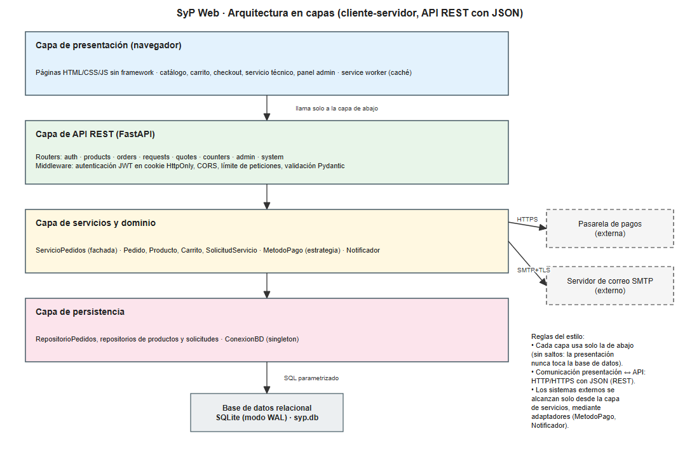
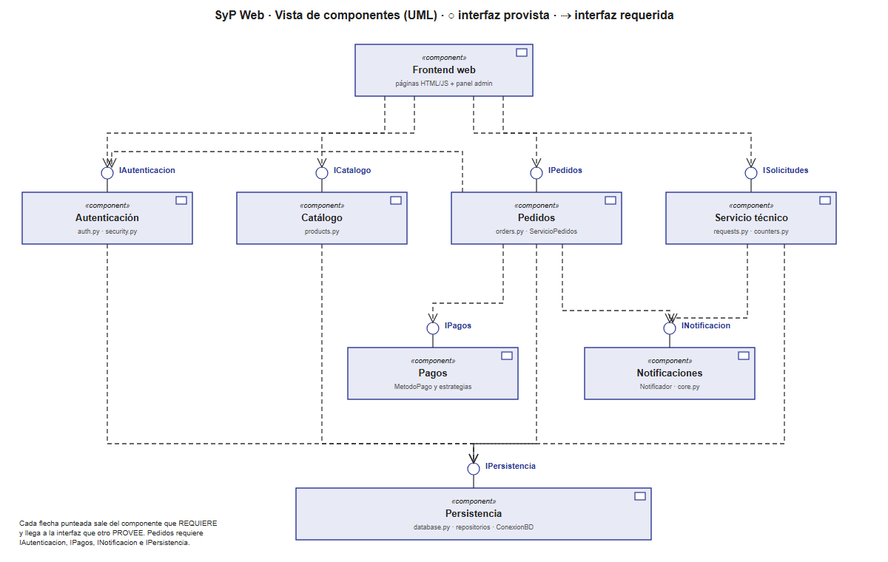
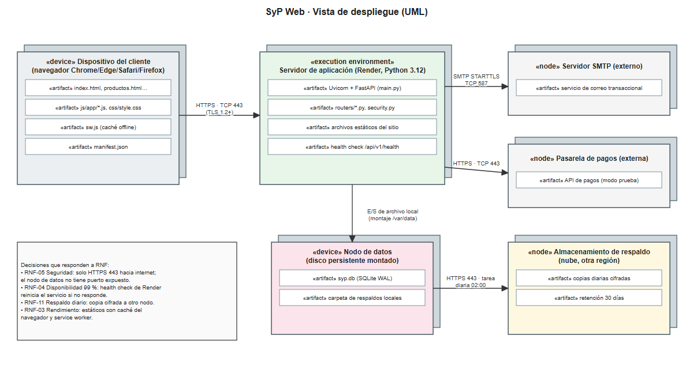

# A4 · Arquitectura · A5 · Vista de componentes · A6 · Vista de despliegue

## A4 · Arquitectura del software

**Estilo:** cliente-servidor en **4 capas** (presentación, API REST, servicios y dominio, persistencia). **Comunicación:** el navegador llama a la API por HTTPS con JSON (REST); dentro del servidor, llamadas directas entre capas; hacia afuera, HTTPS (pasarela) y SMTP con TLS (correo). Cada capa solo llama a la de abajo: **no hay capas saltadas** (la presentación nunca accede a la base de datos).

Diagrama: [`diagramas/A4-arquitectura-capas.drawio`](diagramas/A4-arquitectura-capas.drawio) · [`.svg`](diagramas/A4-arquitectura-capas.svg)

| RNF | Decisión de diseño | Alternativa descartada | Razón del descarte |
|---|---|---|---|
| RNF-05 Seguridad | Middleware de autenticación en la capa API: JWT en cookie HttpOnly, contraseñas con bcrypt (hash y sal), HTTPS obligatorio, consultas SQL parametrizadas en la persistencia | Validar el rol solo en la página (JavaScript) | Cualquiera puede llamar la API directamente y saltarse la pantalla |
| RNF-03 Rendimiento (< 3 s) | Estáticos servidos con caché del navegador y service worker; índices en `producto(id_categoria)` y `pedido(codigo)`; imágenes WebP | Renderizar cada página en el servidor | Más carga en el plan básico del servidor y más tiempo de respuesta |
| RNF-04 Disponibilidad (99 %) | Health check `/api/v1/health` que reinicia el servicio si falla; servicio sin estado en memoria (la sesión va en el token) | Guardar sesiones en memoria del servidor | Un reinicio cerraría todas las sesiones y obligaría a una sola instancia |
| RNF-07 Mantenibilidad | Capas separadas y fachada `ServicioPedidos`; panel admin sobre la misma API | Lógica de negocio dentro de los *routers* | Cada cambio de regla tocaría varios archivos de la API |
| RNF-11 Respaldo diario | Copia diaria cifrada del archivo de base de datos a otro nodo | Respaldo manual cuando se acuerde | No garantiza la frecuencia diaria |
| (estilo) | **4 capas con API REST** | **Microservicios** (un servicio por módulo) | Para 2 desarrolladores y tráfico bajo, multiplica despliegues, costos y puntos de falla sin beneficio |

## A5 · Vista de componentes

Diagrama: [`diagramas/A5-componentes.drawio`](diagramas/A5-componentes.drawio) · [`.svg`](diagramas/A5-componentes.svg)

| Componente | Interfaz que provee | Interfaces que requiere | Clases que agrupa | Requisitos que atiende |
|---|---|---|---|---|
| Frontend web | — (interfaz de usuario) | IAutenticacion, ICatalogo, IPedidos, ISolicitudes | páginas HTML, `js/app/*.js` | RF-01, RF-04, RF-07, RF-08.1-08.4, RF-11 |
| Autenticación | IAutenticacion | IPersistencia | Usuario, Cliente, Administrador, Tecnico | RF-06.1-06.3, RF-10.1, RNF-05 |
| Catálogo | ICatalogo | IPersistencia | Categoria, Producto, Variante | RF-02, RF-03, RF-10.2, RF-10.3 |
| Pedidos | IPedidos | IAutenticacion, IPagos, INotificacion, IPersistencia | ServicioPedidos, Pedido, LineaPedido, Carrito, ItemCarrito | RF-05, RF-06.4, RF-06.5, RF-10.4, RF-10.7, RF-12 |
| Servicio técnico | ISolicitudes | INotificacion, IPersistencia | SolicitudServicio | RF-09, RF-10.5, RF-13, RF-08.5, RF-10.6 |
| Pagos | IPagos | — (pasarela externa) | MetodoPago y sus 3 estrategias, ResultadoPago | RF-05.3 |
| Notificaciones | INotificacion | — (servidor SMTP externo) | Notificador, NotificadorCorreo | RF-05.4, RF-06.3 |
| Persistencia | IPersistencia | — | RepositorioPedidos, ConexionBD | RNF-11 y todos los RF que guardan datos |

Dependencias en una sola dirección (de arriba hacia abajo): ningún componente de abajo depende de uno de arriba.

## A6 · Vista de despliegue

Diagrama: [`diagramas/A6-despliegue.drawio`](diagramas/A6-despliegue.drawio) · [`.svg`](diagramas/A6-despliegue.svg)

| Nodo | Artefactos que aloja | Conexión (protocolo y puerto) | Decisión que responde a un RNF |
|---|---|---|---|
| Dispositivo del cliente | Páginas HTML, JS, CSS, `sw.js`, `manifest.json` | HTTPS TCP 443 (TLS 1.2+) hacia el servidor de aplicación | RNF-05: datos personales cifrados en tránsito; RNF-03: caché del service worker |
| Servidor de aplicación (Render, Python 3.12) | Uvicorn + FastAPI, *routers*, archivos estáticos, health check | E/S de archivo local hacia el nodo de datos; SMTP STARTTLS 587; HTTPS 443 a la pasarela | RNF-04: health check y reinicio automático |
| Nodo de datos (disco persistente) | `syp.db` (SQLite WAL), respaldos locales | Sin puerto expuesto a internet; solo lo monta el servidor de aplicación | RNF-05: la base no es accesible desde afuera |
| Almacenamiento de respaldo (otra región) | Copias diarias cifradas, retención 30 días | HTTPS 443, tarea diaria 02:00 | RNF-11: respaldo diario fuera del nodo principal |
| Servidor SMTP (externo) | Servicio de correo transaccional | SMTP STARTTLS TCP 587 | RNF-05: correo con TLS |
| Pasarela de pagos (externa) | API de pagos | HTTPS TCP 443 | RNF-05: los datos de tarjeta nunca pasan por nuestro servidor |
