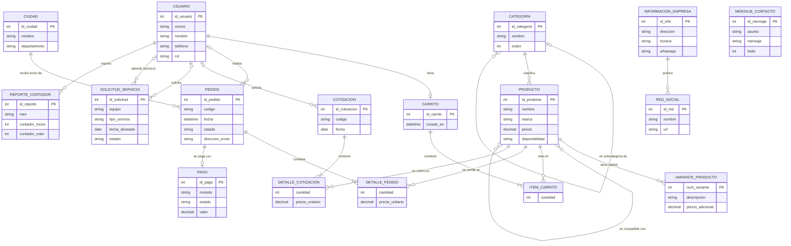

# B1 · Modelo conceptual

**Tipo de base de datos:** relacional (ver justificación en [A1](../G2-P1-fotocopiadora-syp/A1-ficha-interpretacion.md)): pedidos, pagos y productos tienen relaciones fijas y exigen integridad referencial y transacciones.

**Base reutilizada:** el MER de la guía 1 ([G1-P2 · modelo entidad-relación](../../../../01-analysis/03-conceptual-model/04-evidence-learning/G1-P2-fotocopiadora-syp/diagramas/modelo-entidad-relacion.png)). Aquí se evalúa **lo que cambié** para ajustarlo al tipo de base de datos y al diseño:

| # | Ajuste frente a la guía 1 | Motivo |
|---|---|---|
| 1 | Nueva relación recursiva **N:M PRODUCTO «es compatible con» PRODUCTO** | El sistema real guarda `compatible_ids` como lista en un texto (atributo multivaluado). El buscador de repuestos (RF-03.2) necesita saber qué tóner sirve para qué equipo |
| 2 | Nueva entidad **CIUDAD** (nombre, departamento) | Al normalizar el pedido apareció la dependencia transitiva ciudad → departamento (B3) |
| 3 | Atributo multivaluado **redes sociales** de INFORMACION_EMPRESA → entidad **RED_SOCIAL** | 1FN: una red por fila |
| 4 | SOLICITUD_SERVICIO con **dos** relaciones con USUARIO (solicita / atiende) con cardinalidad mínima 0 | Un visitante sin cuenta puede pedir servicio; la solicitud nace sin técnico |
| 5 | El total del pedido se marca como **derivado** | Se calcula desde los detalles; no se almacena (B3) |

## Diagrama (Mermaid · notación pata de gallo · GitHub lo dibuja)

## Relaciones: verbo y cardinalidad mínima y máxima

| Relación (verbo) | Lado A (mín..máx) | Lado B (mín..máx) | Tipo | Requisito |
|---|---|---|---|---|
| CATEGORIA es subcategoría de CATEGORIA | 0..1 | 0..N | 1:N recursiva | RF-02.2 |
| CATEGORIA clasifica PRODUCTO | 1..1 | 0..N | 1:N | RF-02.2, RF-10.3 |
| PRODUCTO tiene VARIANTE_PRODUCTO | 1..1 | 0..N | 1:N identificadora (débil) | RF-03.2 |
| PRODUCTO es compatible con PRODUCTO | 0..N | 0..N | **N:M** recursiva | RF-03.2 |
| USUARIO tiene CARRITO | 1..1 | 0..1 | 1:1 | RF-04.3 |
| CARRITO contiene PRODUCTO (vía ITEM_CARRITO) | 0..N | 0..N | **N:M** | RF-04.1 |
| USUARIO realiza PEDIDO | 0..1 | 0..N | 1:N | RF-05, RF-06.4, RF-06.5 |
| CIUDAD recibe envío de PEDIDO | 1..1 | 0..N | 1:N | RF-05.1 |
| PEDIDO contiene PRODUCTO (vía DETALLE_PEDIDO) | 1..N | 0..N | **N:M** | RF-05.2 |
| PEDIDO se paga con PAGO | 1..1 | 0..1 | 1:1 | RF-05.3 |
| COTIZACION contiene PRODUCTO (vía DETALLE_COTIZACION) | 1..N | 0..N | **N:M** | RF-12 |
| USUARIO solicita / atiende SOLICITUD_SERVICIO | 0..1 | 0..N | 1:N (dos roles) | RF-09 |
| USUARIO reporta REPORTE_CONTADOR | 1..1 | 0..N | 1:N | RF-13 |
| INFORMACION_EMPRESA publica RED_SOCIAL | 1..1 | 0..N | 1:N | RF-08.4 |

**17 entidades** con identificador; **4 relaciones N:M**, **9 relaciones 1:N** (contando los dos roles de USUARIO con SOLICITUD_SERVICIO) y **2 relaciones 1:1**. MENSAJE_CONTACTO no se relaciona (se guarda aunque el remitente no tenga cuenta; RF-08.5).
