# B2 · Modelo lógico relacional

**18 tablas**, todas con PK; **20 FK**. Script: [`sql/B5-crear-modelo.sql`](sql/B5-crear-modelo.sql) · diccionario: [B4](B4-diccionario-datos.md).

> El modelo conceptual tiene 17 entidades y el lógico 18 tablas: la N:M recursiva «es compatible con» se convierte en la tabla `compatibilidad_producto`, y la entidad USUARIO absorbe la generalización Cliente / Administrador / Técnico (columna `rol`).

> **Propuesta frente a lo implementado (ajuste del día 2).** Estas 18 tablas son el modelo **propuesto** y normalizado. La base que usa hoy el sistema del equipo (`fastapi_backend/database.py`) tiene **9 tablas** con nombres en inglés (`users`, `categories`, `products`, `maintenance_requests`, `contact_messages`, `quotes`, `counter_reports`, `orders`, `notifications`) y guarda los productos de cada pedido y cotización como texto JSON (`items_json`). Pasar a este modelo es trabajo futuro; [B3](B3-normalizacion.md) explica por qué conviene (el `items_json` incumple la 1FN).

## Diagrama lógico (Mermaid · GitHub lo dibuja)

```mermaid
erDiagram
  categoria ||--o{ categoria : id_categoria_padre
  categoria ||--o{ producto : id_categoria
  producto ||--o{ variante_producto : id_producto
  producto ||--o{ compatibilidad_producto : id_producto
  producto ||--o{ compatibilidad_producto : id_producto_compatible
  usuario ||--o| carrito : id_usuario
  carrito ||--|{ item_carrito : id_carrito
  producto ||--o{ item_carrito : id_producto
  usuario |o--o{ pedido : id_usuario
  ciudad ||--o{ pedido : id_ciudad
  pedido ||--|{ detalle_pedido : id_pedido
  producto ||--o{ detalle_pedido : id_producto
  pedido ||--o| pago : id_pedido
  usuario |o--o{ cotizacion : id_usuario
  cotizacion ||--|{ detalle_cotizacion : id_cotizacion
  producto ||--o{ detalle_cotizacion : id_producto
  usuario |o--o{ solicitud_servicio : id_usuario
  usuario |o--o{ solicitud_servicio : id_tecnico
  usuario ||--o{ reporte_contador : id_usuario
  informacion_empresa ||--o{ red_social : id_info
  usuario {
    INTEGER id_usuario PK
    VARCHAR correo UK
    VARCHAR rol
    VARCHAR contrasena_hash
  }
  categoria {
    INTEGER id_categoria PK
    VARCHAR nombre UK
    INTEGER id_categoria_padre FK
  }
  producto {
    INTEGER id_producto PK
    INTEGER id_categoria FK
    VARCHAR nombre UK
    DECIMAL precio
  }
  variante_producto {
    INTEGER id_producto PK,FK
    INTEGER num_variante PK
  }
  compatibilidad_producto {
    INTEGER id_producto PK,FK
    INTEGER id_producto_compatible PK,FK
  }
  carrito {
    INTEGER id_carrito PK
    INTEGER id_usuario FK,UK
  }
  item_carrito {
    INTEGER id_carrito PK,FK
    INTEGER id_producto PK,FK
    INTEGER cantidad
  }
  ciudad {
    INTEGER id_ciudad PK
    VARCHAR nombre
    VARCHAR departamento
  }
  pedido {
    INTEGER id_pedido PK
    VARCHAR codigo UK
    INTEGER id_usuario FK
    INTEGER id_ciudad FK
    VARCHAR estado
  }
  detalle_pedido {
    INTEGER id_pedido PK,FK
    INTEGER id_producto PK,FK
    INTEGER cantidad
    DECIMAL precio_unitario
  }
  pago {
    INTEGER id_pago PK
    INTEGER id_pedido FK,UK
    VARCHAR metodo
    DECIMAL valor
  }
  cotizacion {
    INTEGER id_cotizacion PK
    VARCHAR codigo UK
    INTEGER id_usuario FK
  }
  detalle_cotizacion {
    INTEGER id_cotizacion PK,FK
    INTEGER id_producto PK,FK
    INTEGER cantidad
  }
  solicitud_servicio {
    INTEGER id_solicitud PK
    INTEGER id_usuario FK
    INTEGER id_tecnico FK
    VARCHAR estado
  }
  reporte_contador {
    INTEGER id_reporte PK
    INTEGER id_usuario FK
    CHAR mes
  }
  mensaje_contacto {
    INTEGER id_mensaje PK
    VARCHAR asunto
    INTEGER leido
  }
  informacion_empresa {
    INTEGER id_info PK
    VARCHAR whatsapp
  }
  red_social {
    INTEGER id_red PK
    INTEGER id_info FK
    VARCHAR url UK
  }
```

(El diagrama muestra las columnas clave de cada tabla; todas las columnas están en el diccionario B4 y en el script.)

## Cuadro de reglas de transformación aplicadas

| Regla | Caso de SyP Web | Resultado en el modelo lógico |
|---|---|---|
| Entidad fuerte → tabla con PK | USUARIO, PRODUCTO, PEDIDO, etc. | Una tabla por entidad, PK `id_<tabla>` |
| Relación **1:N** → FK en el lado «muchos» | CATEGORIA clasifica PRODUCTO | `producto.id_categoria` FK NOT NULL (participación total) |
| 1:N con participación parcial → FK que admite nulo | USUARIO realiza PEDIDO (0..1, invitado) | `pedido.id_usuario` FK nula, `ON DELETE SET NULL` |
| Relación **1:1** → FK única | PEDIDO se paga con PAGO; USUARIO tiene CARRITO | `pago.id_pedido` FK UNIQUE; `carrito.id_usuario` FK UNIQUE |
| Relación **N:M** → tabla intermedia con PK compuesta | PEDIDO–PRODUCTO, COTIZACION–PRODUCTO, CARRITO–PRODUCTO | `detalle_pedido`, `detalle_cotizacion`, `item_carrito` con PK (FK1, FK2) y atributos propios |
| **N:M recursiva** → tabla intermedia con dos FK a la misma tabla | PRODUCTO es compatible con PRODUCTO | `compatibilidad_producto(id_producto, id_producto_compatible)` + CHECK de que no sean iguales |
| **Relación recursiva 1:N** → FK a la misma tabla | CATEGORIA es subcategoría de CATEGORIA | `categoria.id_categoria_padre` FK → `categoria` |
| **Entidad débil** → PK compuesta con la PK de la fuerte | VARIANTE_PRODUCTO | PK (`id_producto`, `num_variante`), `ON DELETE CASCADE` |
| **Atributo multivaluado** → tabla aparte | Redes sociales de la empresa; modelos compatibles (antes `compatible_ids`) | `red_social(id_red, id_info, nombre, url)`; `compatibilidad_producto` |
| **Generalización** → una tabla con discriminador | Usuario → Cliente, Administrador, Técnico | Tabla `usuario` con `rol` CHECK IN (...); `nit` solo lo usa el cliente. Se eligió una sola tabla porque los subtipos casi no tienen atributos propios y comparten el inicio de sesión |
| Relación con dos roles → dos FK | USUARIO solicita / atiende SOLICITUD | `solicitud_servicio.id_usuario` y `solicitud_servicio.id_tecnico` |
| Atributo derivado → no se guarda | Total del pedido | Vista `v_total_pedido` (subtotal, IVA 19 %, total) |
