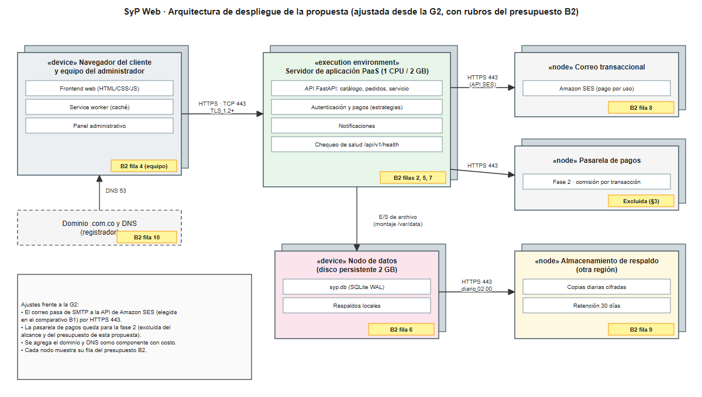

# Propuesta técnica · SyP Web · versión 1.0

**Para:** propietaria de Fotocopiadoras SyP (Neiva, Huila) · **De:** `Kevin81A` (equipo de desarrollo SyP Web) · **Fecha:** 2026-11-26 · **Variante del escenario:** A (asumida) · **Vigencia de la oferta:** 30 días calendario.

---

## 1. Resumen ejecutivo

Fotocopiadoras SyP vende equipos, insumos y servicio técnico, y hoy atiende casi todo por WhatsApp y en el local. Proponemos **SyP Web**: una tienda en línea con catálogo, carrito y pedidos, un módulo de solicitudes de servicio técnico, cotizaciones con IVA y un panel para que el personal maneje productos, precios y pedidos sin depender de un programador.

- **Plazo:** 40 días hábiles (unas 8 semanas) desde la firma.
- **Costo del primer año:** $26.598.798 con contingencia y sin margen. **Precio de venta:** $33.248.497 antes de IVA y **$39.565.711 con IVA**, dentro del tope de la variante ($45.000.000).
- **Operación desde el año 2:** ≈ $5.120.000 al año (hosting, correo, respaldo, dominio y 8 h mensuales de soporte).
- **Garantía:** 3 meses de corrección de defectos sin costo.

## 2. Entendimiento de la necesidad

- La información de productos y precios está dispersa: el cliente pregunta por WhatsApp y espera respuesta.
- Las solicitudes de servicio técnico no quedan registradas ni tienen seguimiento de estado.
- Las cotizaciones para empresas se arman a mano.
- La propietaria necesita actualizar catálogo y precios sin un programador (RNF-07).
- Hay que proteger los datos personales de los clientes (Ley 1581 de 2012).

El detalle está en el informe de análisis de la G1 y en el SRS v2.1 (42 requisitos funcionales y 11 no funcionales).

## 3. Alcance

**Incluye:** catálogo con filtros y búsqueda; ficha de producto con variantes y ficha técnica; carrito; checkout con pago por transferencia o contraentrega; cuentas de cliente e historial; solicitudes de servicio técnico con estados; cotizaciones con IVA; reporte de contadores de renting; páginas institucionales y de contacto; panel administrativo; respaldo diario; capacitación de 6 h; despliegue en la nube y dominio.

**Excluye:** pasarela de pago en línea (fase 2; la arquitectura ya la soporta con la estrategia `PagoEnLinea`); comisiones de la pasarela; facturación electrónica DIAN; app móvil nativa; contenido (fotos y textos) más allá de la carga inicial de hasta 200 productos.

**Supuestos:** la propietaria entrega el catálogo (nombres, precios, fotos) en la semana 2; hay una persona disponible 30 minutos por semana para validar; 60 usuarios y 15 concurrentes (variante A).

## 4. Solución y arquitectura

Aplicación web en 4 capas (presentación, API REST, servicios y dominio, persistencia), Python con FastAPI y base de datos relacional SQLite, desplegada en un servidor PaaS con disco persistente y respaldo diario en otra región. Diseño completo en la G2 (clases, patrones Estrategia, Fachada y Singleton, componentes y modelo de datos en 3FN).

Diagrama de despliegue de la propuesta, **ajustado desde la G2** (correo por la API de Amazon SES, pasarela en fase 2 y dominio con costo). Cada nodo indica su fila del presupuesto:

Fuente editable: [`diagramas/arquitectura-despliegue-propuesta.drawio`](diagramas/arquitectura-despliegue-propuesta.drawio)

| Nodo o componente | Protocolo | Rubro del presupuesto B2 |
|---|---|---|
| Navegador y equipo del administrador | HTTPS 443 | Fila 4 (equipo de cómputo) |
| Servidor de aplicación (API, autenticación, pagos, notificaciones) | HTTPS 443 | Filas 2 (desarrollo), 5 (cómputo), 7 (banda) |
| Nodo de datos (disco 2 GB) | E/S de archivo local | Fila 6 |
| Almacenamiento de respaldo | HTTPS 443 | Fila 9 |
| Correo transaccional (Amazon SES) | HTTPS 443 | Fila 8 |
| Dominio y DNS | DNS 53 | Fila 10 |
| Pasarela de pagos | HTTPS 443 | Excluida (fase 2) |

## 5. Especificaciones técnicas

Se remite al **Producto 1** de esta guía: formato y 4 fichas técnicas medibles ([A1-A2](../G3-P1-fotocopiadora-syp/A1-A2-fichas-tecnicas.md)), referentes legales ([A3](../G3-P1-fotocopiadora-syp/A3-referentes-tecnicos.md)), licencias ([A4](../G3-P1-fotocopiadora-syp/A4-licencias.md)) y condiciones técnicas ([A5](../G3-P1-fotocopiadora-syp/A5-condiciones-tecnicas.md)). Principales: 15 usuarios concurrentes con API ≤ 800 ms, páginas ≤ 3 s, disponibilidad 99,0 % mensual, RPO 24 h y RTO 4 h, WCAG 2.2 AA.

## 6. Metodología y cronograma

Scrum con sprints de 1 semana y revisión con la propietaria cada viernes (30 minutos). EDT de 11 tareas con ruta crítica calculada (holgura = inicio tardío − inicio temprano):

| ID | Tarea | Duración (días hábiles) | Predecesoras | Inicio temprano | Fin temprano | Inicio tardío | Fin tardío | Holgura | ¿Crítica? |
|---|---|---|---|---|---|---|---|---|---|
| T1 | Validar requisitos y alcance con la propietaria | 5 | — | 0 | 5 | 0 | 5 | 0 | **Sí** |
| T2 | Diseño: arquitectura y modelo de datos | 6 | T1 | 5 | 11 | 5 | 11 | 0 | **Sí** |
| T3 | Prototipo de interfaz | 4 | T1 | 5 | 9 | 9 | 13 | 4 | No |
| T4 | Módulo catálogo y fichas | 8 | T2, T3 | 11 | 19 | 13 | 21 | 2 | No |
| T5 | Cuentas y autenticación | 5 | T2 | 11 | 16 | 11 | 16 | 0 | **Sí** |
| T6 | Carrito, checkout y pagos | 10 | T4, T5 | 19 | 29 | 21 | 31 | 2 | No |
| T7 | Servicio técnico, cotizaciones y contadores | 7 | T5 | 16 | 23 | 16 | 23 | 0 | **Sí** |
| T8 | Panel administrativo | 8 | T4, T7 | 23 | 31 | 23 | 31 | 0 | **Sí** |
| T9 | Pruebas integrales y de seguridad | 5 | T6, T8 | 31 | 36 | 31 | 36 | 0 | **Sí** |
| T10 | Despliegue y migración de datos | 2 | T9 | 36 | 38 | 36 | 38 | 0 | **Sí** |
| T11 | Capacitación y entrega | 2 | T10 | 38 | 40 | 38 | 40 | 0 | **Sí** |

**Ruta crítica:** T1 → T2 → T5 → T7 → T8 → T9 → T10 → T11 · **duración total: 40 días hábiles**.

**Hitos:** H1 requisitos validados (día 5) · H2 diseño aprobado (día 11) · H3 tienda funcional en pruebas (día 31) · H4 puesta en producción (día 38) · H5 entrega y acta de cierre (día 40).

## 7. Equipo y roles

| Rol | Persona | Dedicación |
|---|---|---|
| Analista, líder técnico y *Product Owner* delegado | `Kevin81A` | 100 % |
| Desarrollador y *Scrum Master* | Co-desarrollador del equipo | 100 % |
| Validación de negocio | Propietaria de Fotocopiadoras SyP | 30 min/semana |

## 8. Costos

Detalle en la hoja con fórmulas [B2-presupuesto.xlsx](B2-presupuesto.xlsx) y en el comparativo [B1-comparativo-proveedores.xlsx](B1-comparativo-proveedores.xlsx).

| Concepto | Valor (COP) |
|---|---|
| Subtotal (talento, licencias, equipo, nube, capacitación, soporte e indirectos 8 %) | 23.713.798 |
| Contingencia (suma de valores esperados de los riesgos cubiertos = 12,2 %) | 2.885.000 |
| **Costo total año 1** | **26.598.798** |
| Precio antes de IVA (margen del 20 % sobre el precio: costo ÷ 0,8) | 33.248.497 |
| IVA 19 % | 6.317.214 |
| **Precio de venta con IVA** | **39.565.711** |
| Operación anual desde el año 2 (recurrentes + 8 % indirectos) | ≈ 5.119.978 |

El costo cabe en el tope de la variante A ($45.000.000), y también el precio con margen e IVA.

## 9. Matriz de riesgos

| N.º | Riesgo | Causa | Probabilidad | Impacto (COP) | Valor esperado (COP) | Respuesta | Responsable |
|---|---|---|---|---|---|---|---|
| R1 | Cambia el método de pago o la pasarela | RF-05.3 abierto | 40 % | 2.100.000 | 840.000 | Mitigar: estrategia `MetodoPago`; pasarela en fase 2 | `Kevin81A` |
| R2 | Retraso por poca disponibilidad de la propietaria | Atiende el local | 30 % | 1.400.000 | 420.000 | Mitigar: revisión semanal corta y validación por WhatsApp | `Kevin81A` |
| R3 | Sube el precio del hosting | Dependencia de un PaaS | 20 % | 800.000 | 160.000 | Aceptar (no se cubre con reserva): arquitectura portable | Co-desarrollador |
| R4 | Pérdida de datos por falla del disco | Base en un archivo | 5 % | 6.000.000 | 300.000 | Mitigar: respaldo diario y restauración probada | Co-desarrollador |
| R5 | Fuga de datos personales | Vulnerabilidad | 10 % | 8.000.000 | 800.000 | Mitigar: hash con sal, HTTPS, pruebas de seguridad | `Kevin81A` |
| R6 | Sale el co-desarrollador | Equipo de 2 | 15 % | 3.500.000 | 525.000 | Mitigar: documentación y repositorio compartido | `Kevin81A` |

Contingencia = R1 + R2 + R4 + R5 + R6 = **$2.885.000** (R3 se acepta sin reserva).

## 10. Garantías y soporte

- **Garantía:** 3 meses desde el acta de entrega: corrección sin costo de defectos frente a las fichas técnicas.
- **Soporte:** 8 horas al mes incluidas en la operación (ajustes menores, actualizaciones de seguridad, monitoreo).
- **ANS:** disponibilidad 99,0 % mensual, respuesta a incidentes críticos en ≤ 4 h hábiles, RPO 24 h y RTO 4 h (detalle en [B6](B6-contrato-tdr-ans.md)).

## 11. Condiciones comerciales y de propiedad intelectual

- **Forma de pago:** 30 % a la firma · 30 % en el hito H3 (tienda funcional en pruebas) · 40 % en la entrega (H5).
- **Propiedad intelectual:** los derechos patrimoniales del software se ceden a la propietaria al pagar el total (Ley 23 de 1982); los autores conservan los derechos morales. Se entrega el código fuente. Las librerías de terceros conservan sus licencias permisivas (MIT, BSD, Apache-2.0).
- **Datos personales:** la propietaria es la responsable del tratamiento y el equipo es el encargado durante el desarrollo y el soporte (Ley 1581 de 2012).
- **Confidencialidad:** la información del negocio no se divulga.

## 12. Vigencia de la oferta y anexos

**Vigencia:** 30 días calendario desde la fecha de este documento. Los precios en dólares se recalculan si la TRM varía más de 10 %.

**Anexos:** Producto 1 de la G3 (especificaciones) · [B1 Comparativo de proveedores](B1-comparativo-proveedores.xlsx) · [B2 Presupuesto](B2-presupuesto.xlsx) · [B6 Contrato, términos de referencia y ANS](B6-contrato-tdr-ans.md) · diseño de la G2 (clases, componentes, modelo de datos) · análisis de la G1 (casos de uso, MER, prototipo).
