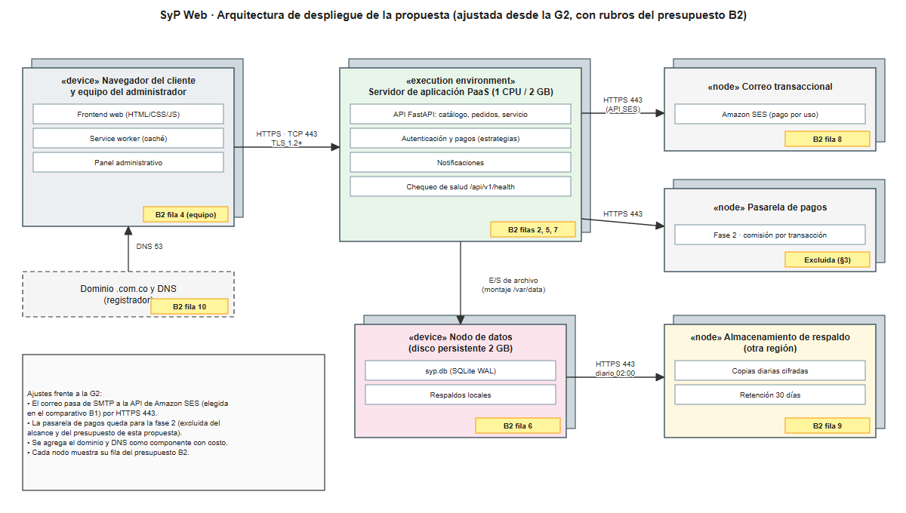

<!-- Presentación de 10 diapositivas (formato Marp: se puede abrir con la extensión Marp de VS Code y exportar a PDF o PPTX). Duración: 10 minutos. -->

# SyP Web
## Su tienda y su servicio técnico, en línea

Propuesta para Fotocopiadoras SyP · Neiva · `Kevin81A` · diciembre de 2026

---

## Propósito de esta reunión (guía interna de negociación)

- **Objetivo:** acordar alcance, precio y fecha de inicio de la fase 1.
- **Posición ideal:** fase 1 completa a $39,6 M con IVA, pago 30/30/40.
- **Posición mínima:** fase 1 sin el módulo de cotizaciones y contadores (29,3 h PERT ≈ $1.026.667 de costo; con indirectos, margen e IVA ≈ $1,65 M menos) a ≈ $37,9 M con IVA.
- **Mejor alternativa si no hay acuerdo (MAAN):** ofrecer solo el catálogo con pedidos por WhatsApp como piloto de 4 semanas y retomar la negociación con resultados.

---

## 1. El problema

- Los clientes preguntan precios y existencias por WhatsApp y esperan.
- Las solicitudes de servicio técnico se pierden: no hay seguimiento.
- Las cotizaciones para empresas se hacen a mano.
- Cambiar un precio depende de otra persona.

---

## 2. El beneficio

- Catálogo y precios disponibles las 24 horas, también desde el celular.
- Cada pedido y cada solicitud quedan registrados, con estado y número.
- Cotización con IVA en minutos.
- Usted misma cambia productos y precios desde el panel.

---

## 3. La solución

- Tienda: catálogo, carrito y pedido con transferencia o contraentrega.
- Servicio técnico: solicitud con fecha y seguimiento.
- Panel: productos, pedidos, solicitudes, mensajes y estadísticas.
- En la nube, con respaldo diario y datos protegidos (Ley 1581).

---

## 4. Costo

| Concepto | Valor |
|---|---|
| Precio de la fase 1 (con IVA) | **$39.565.711** |
| Forma de pago | 30 % firma · 30 % tienda en pruebas · 40 % entrega |
| Operación desde el año 2 | ≈ $5,1 M al año (hosting, correo, respaldo, soporte de 8 h/mes) |

---

## 5. Plazo

- **40 días hábiles** (unas 8 semanas).
- Revisión con usted cada viernes, 30 minutos.
- Hitos: requisitos (día 5) · diseño (día 11) · tienda en pruebas (día 31) · en línea (día 38) · entrega (día 40).

---

## 6. Riesgos y cómo los manejamos

- Pasarela de pago en línea aún sin definir → **fase 2**, sin rehacer nada.
- Su tiempo es limitado → validaciones cortas y por WhatsApp.
- Pérdida de datos → copia diaria y prueba de restauración mensual.
- Reserva de contingencia: $2,9 M incluidos en el precio.

---

## 7. Objeciones que esperamos

| Objeción | Respuesta |
|---|---|
| «Es muy caro» | Se puede dejar cotizaciones y contadores para después (≈ −$1,65 M con IVA); el costo de operar es menor que un día de ventas al mes |
| «Quiero pago con tarjeta ya» | La arquitectura lo trae preparado; se contrata en la fase 2 con la pasarela que usted elija |
| «¿Y si ustedes se van?» | Recibe el código fuente, los derechos patrimoniales y el manual; cualquier desarrollador puede continuar |
| «No tengo tiempo para reuniones» | Solo 30 minutos a la semana; el resto se valida por WhatsApp |

---

## 8. Siguientes pasos

1. Sus comentarios hoy (quedan en el acta).
2. Ajustamos la propuesta (versión 1.1) en 2 días.
3. Firma y primer pago → arrancamos el lunes siguiente.

**Gracias.**
